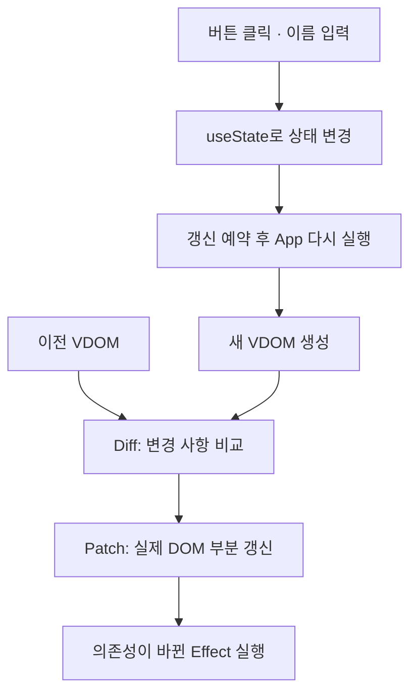

Mini React
===========

JavaScript로 Virtual DOM, Diff·Patch, 함수형 컴포넌트와 Hooks를 직접 구현한 프로젝트입니다.

사용자가 버튼을 누르거나 이름을 입력하면 상태가 바뀌고, 새 Virtual DOM과 이전 Virtual DOM을 비교해 변경 사항을 실제 DOM에 반영합니다.
외부 프레임워크 없이 컴포넌트 실행부터 상태 유지, 화면 갱신까지 연결했습니다.

## 동작 구조



- 상태는 `hooks` 배열에 저장하고, 갱신이 예약되면 `App`과 자식 컴포넌트를 실행해 새 VDOM을 만듭니다.
- 이전 VDOM과 비교한 변경 목록을 실제 DOM에 적용하며, 유지할 DOM 노드는 재사용합니다.
- 갱신한 VDOM은 다음 비교의 기준으로 저장하고, DOM 반영 후 의존성이 바뀐 Effect를 실행합니다.

## 브라우저에서 DOM을 다루는 방법

| 대상 | 역할 | 프로젝트에서의 사용 |
| --- | --- | --- |
| `Window` | 문서가 실행되는 브라우저 환경과 전역 API 제공 | `DOMContentLoaded` 이벤트를 받아 앱 시작 |
| `Document` | 문서의 DOM 트리에 접근하고 노드를 생성 | `getElementById()`로 마운트 위치 조회, `createElement()`·`createTextNode()`로 DOM 생성 |
| DOM 노드 | 화면을 구성하는 요소·텍스트와 부모/자식 관계 | `appendChild()`, `insertBefore()`, `removeChild()`, `replaceChild()`로 변경 반영 |

프로젝트의 `createElement()`는 VDOM을 만드는 함수입니다. 실제 DOM을 만드는 `document.createElement()`와 구분합니다.
관련 API: [Window](https://developer.mozilla.org/en-US/docs/Web/API/Window), [Document](https://developer.mozilla.org/en-US/docs/Web/API/Document).

### 실제 DOM의 변경 감지

`MutationObserver`는 자식 노드 추가·삭제, 속성, 텍스트 변경을 관찰하는 브라우저 API입니다.
`childList`, `attributes`, `characterData`, `subtree` 등의 옵션으로 관찰 범위를 지정합니다.
입력창의 현재 `value` 같은 프로퍼티 변경은 DOM 속성 변경과 구분하고, 사용자 입력은 `input`·`change` 이벤트로 처리합니다.
API 설명: [MutationObserver](https://developer.mozilla.org/en-US/docs/Web/API/MutationObserver).

현재 구현은 상태 변경을 출발점으로 Diff·Patch를 실행하며, `MutationObserver`를 사용하지 않습니다.
DOM 변경 감지와 다음 화면의 변경 사항을 계산하는 Diff는 서로 다른 역할입니다.

### Reflow · Repaint와 DOM 갱신 비용

- **Reflow(Layout)**: 요소의 크기와 위치를 계산합니다. 내용·크기 변경이 주변 요소의 배치에도 영향을 줄 수 있습니다.
- **Repaint(Paint)**: 계산된 배치와 스타일에 따라 픽셀을 그립니다. 색상처럼 배치를 바꾸지 않는 변화도 다시 그리기를 유발할 수 있습니다.
- 브라우저는 여러 변경을 모아서 처리할 수 있습니다. DOM API 호출 횟수와 Reflow·Repaint 횟수가 항상 일치하지는 않습니다.

이 프로젝트는 기존 DOM을 재사용하고 상태 변경을 모아 불필요한 DOM 작업을 줄이는 것을 목표로 합니다.
VDOM 생성과 비교에도 비용이 들기 때문에 성능 개선 여부는 실제 화면과 변경 패턴을 기준으로 측정해야 합니다.
렌더링 과정: [MDN — Critical rendering path](https://developer.mozilla.org/en-US/docs/Web/Performance/Guides/Critical_rendering_path).

## Virtual DOM · Diff · Patch

`createElement()`가 태그, 속성, 자식, 이벤트, 입력 프로퍼티를 가진 Virtual DOM을 생성합니다.
Diff는 두 트리의 차이를 변경 목록으로 만들고, Patch는 해당 목록을 실제 DOM에 적용합니다.

### Virtual DOM의 구조와 역할

VDOM은 화면 구조를 표현하는 일반 JavaScript 객체입니다.

```js
const virtualDOM = {
  type: "p",               // 태그
  props: { class: "count" }, // HTML 속성
  children: ["숫자: 1"],    // 문자열 또는 자식 VDOM
  events: {},              // 이벤트 함수
  domProps: {}             // value, checked 등 현재 입력 상태
};
```

이전 화면과 다음 화면을 데이터로 비교할 수 있어, 컴포넌트가 선언한 결과를 실제 DOM에 반영하는 기준이 됩니다.
최초 렌더링에서는 DOM을 생성하고, 이후에는 이전 VDOM과 새 VDOM을 비교해 기존 DOM을 갱신합니다.

### Diff의 5가지 기본 경우

같은 위치의 두 노드를 비교하고, 자식도 같은 방식으로 재귀적으로 비교합니다.
값이 같으면 변경 목록을 만들지 않고, 차이가 있으면 다음 기준으로 처리합니다.

| 경우 | 예시 | 변경 목록 |
| --- | --- | --- |
| 추가 | 이전 노드가 없고 다음 노드가 있음 | `ADD` |
| 삭제 | 이전 노드가 있고 다음 노드가 없음 | `REMOVE` |
| 교체 | `p`가 `div`로 변경되거나 텍스트와 요소가 서로 바뀜 | `REPLACE` |
| 텍스트 변경 | `"숫자: 0"`이 `"숫자: 1"`로 변경 | `TEXT` |
| 속성 변경 | `class`가 바뀌거나 속성이 추가·삭제됨 | `SET_PROP`, `REMOVE_PROP` |

이벤트 함수와 입력 프로퍼티는 각각 `SET_EVENT`, `SET_DOM_PROP`로 구분합니다.
현재는 자식을 인덱스로 대응시키므로 목록 중간 삽입·순서 변경에서 추가 수정이 발생할 수 있으며, 전역적으로 최소인 변경 횟수를 보장하지는 않습니다.

### 변경 목록을 실제 DOM에 반영

Patch는 경로에 해당하는 DOM을 찾아 추가·삭제·교체 메서드나 `nodeValue`, `setAttribute()` 등을 적용합니다.

- 같은 인덱스의 자식끼리 재귀적으로 비교하며, 교체 대상이 아닌 기존 DOM 노드를 재사용합니다.
- 여러 형제 노드를 삭제할 때 인덱스가 밀리지 않도록 변경 전에 대상 DOM을 찾아 둡니다.
- 이전 이벤트 함수를 제거한 뒤 새 함수를 등록해 중복 등록을 방지합니다.
- DOM 프로퍼티는 구조와 속성 변경이 끝난 뒤 반영합니다. 같은 입력값은 재대입하지 않아 불필요한 커서 이동을 줄입니다.

구현: [diffVirtualDOM.js](virtualDOM/diffVirtualDOM.js), [patchDOM.js](virtualDOM/patchDOM.js)

## 함수형 컴포넌트와 상태 분리

- UI를 숫자 표시·증가를 담당하는 `Counter`와 이름 입력을 담당하는 `NameInput`으로 나눕니다.
- 루트 `App`에서 숫자와 이름 상태를 관리합니다.
- 자식 `Counter`, `NameInput`은 전달받은 props로 Virtual DOM을 반환합니다.
- 부모가 상태 변경 함수를 props로 전달하고, 자식은 사용자 입력을 그 함수에 전달합니다.
- `createElement()`로 실행한 자식 컴포넌트에서는 Hook 호출을 차단합니다.

```text
App — count, name 상태 관리
├─ NameInput — name과 입력 처리 함수 전달
└─ Counter   — count와 증가 처리 함수 전달
```

구현: [components.js](virtualDOM/components.js), [createElement.js](virtualDOM/createElement.js)

여러 컴포넌트가 함께 사용하는 상태는 가장 가까운 공통 부모에 두고, 값과 변경 함수를 props로 전달할 수 있습니다.
이 과제에서는 루트만 상태를 관리한다는 제약에 맞춰 `App`이 모든 상태를 소유합니다.
관련 개념: [React — Sharing State Between Components](https://react.dev/learn/sharing-state-between-components).

## 함수를 다시 실행해도 유지되는 상태

- `FunctionComponent` 인스턴스에 `hooks` 배열을 보관합니다.
- 렌더링을 시작할 때 Hook 인덱스를 0으로 초기화하고, 호출 순서대로 기존 저장 공간을 사용합니다.
- `App` 함수가 다시 실행되어도 같은 인스턴스의 상태를 읽습니다.
- 렌더링 간 Hook 호출 개수나 종류의 순서가 달라지면 오류를 발생시킵니다.

구현: [FunctionComponent.js](virtualDOM/FunctionComponent.js), [hooks.js](virtualDOM/hooks.js)

## 여러 상태 변경을 모으는 Batching

`updateScheduled`로 중복 예약을 막고, `queueMicrotask()`로 현재 동기 코드가 끝난 뒤 화면을 갱신합니다.
다음 코드를 같은 이벤트 핸들러 안에서 실행하면, 저장된 상태는 순서대로 증가하고 렌더링은 한 번 예약됩니다.

```js
setCount(value => value + 1);
setCount(value => value + 1);
setCount(value => value + 1);
```

초기값이 0이면 다음 화면에는 3이 표시됩니다.
현재 렌더링에서 받은 `count` 변수는 그대로이므로 연속 증가에는 함수형 갱신을 사용합니다.

이 구현은 setter 호출 시 저장된 값을 바로 계산하고 **렌더링 예약을 묶는 방식**입니다.
React는 상태 갱신을 큐에 넣고 다음 렌더링에서 처리하므로 내부 처리 방식에는 차이가 있습니다.
비교 자료: [React — Queueing a Series of State Updates](https://react.dev/learn/queueing-a-series-of-state-updates).

## 실제 React와의 동작 비교

React도 업데이트가 발생하면 컴포넌트를 실행해 다음 UI를 계산하고, Commit 단계에서 실제 DOM을 변경합니다.
컴포넌트 함수가 다시 실행되는 것과 실제 DOM 전체가 다시 생성되는 것은 구분해야 합니다.
설명: [React — Render and Commit](https://react.dev/learn/render-and-commit).

| 항목 | 이 프로젝트 | React |
| --- | --- | --- |
| 상태 소유 | 루트 인스턴스에만 Hook과 상태 보관 | 각 함수형 컴포넌트에서 Hook과 상태 사용 가능 |
| 자식 대응 | 같은 인덱스끼리 비교 | 타입·트리 위치와 목록의 `key` 등을 이용해 대응 |
| 상태 갱신 | setter에서 저장값을 계산하고 마이크로태스크로 렌더링 예약 | 상태 갱신을 큐에 넣고 렌더링에서 처리 |
| Effect 실행 | DOM 반영 직후 동기 실행 | 보통 브라우저 Paint 후 실행하며, 사용자 상호작용에 따라 Paint 전에 실행될 수도 있음 |

자식 대응은 [React — Preserving and Resetting State](https://react.dev/learn/preserving-and-resetting-state)와 [Rendering Lists](https://react.dev/learn/rendering-lists), Effect 실행 시점은 [React — useEffect](https://react.dev/reference/react/useEffect)를 참고했습니다.
이 프로젝트는 상태·렌더링·DOM 반영의 연결을 확인하는 데 집중하며, React의 전체 조정·스케줄링 기능을 구현하지는 않습니다.

## 파일 구성

```text
virtualDOM/
├─ virtualDOM.html       # 실행 페이지와 루트 마운트
├─ components.js         # App, Counter, NameInput
├─ FunctionComponent.js  # 렌더링·Hook 저장 공간·생명주기 관리
├─ hooks.js              # useState, useEffect, useMemo
├─ createElement.js      # Virtual DOM 생성과 자식 함수 실행
├─ diffVirtualDOM.js     # 변경 목록 계산
└─ patchDOM.js           # 실제 DOM 생성과 부분 갱신
```
