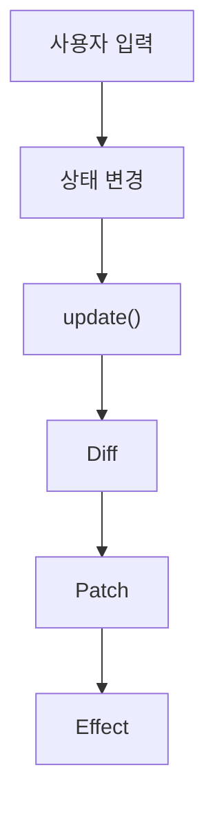

# Mini React — 랜덤 룰렛

JavaScript로 직접 구현한 Virtual DOM, Diff·Patch, 함수형 컴포넌트와 Hooks로 만든 랜덤 룰렛입니다.

## 동작 구조

- 이름 입력, 칸 추가·삭제, 돌리기 버튼이 상태를 바꾸면 `App`을 다시 실행해 새 Virtual DOM을 만듭니다.
- 이전 Virtual DOM과 비교해 바뀐 부분만 실제 DOM에 반영합니다.
- 반영이 끝나면 탭 제목 변경, 3초 뒤 멈춤 같은 `useEffect` 작업을 실행합니다.

## Virtual DOM · Diff · Patch

`h()`로 만든 Virtual DOM을 이전 것과 비교하고, 변경 목록만 실제 DOM에 적용합니다.

소스: [`vdom.js`](./vdom.js) · [`diff.js`](./diff.js) · [`patch.js`](./patch.js)

### Diff의 5가지 기본 경우

| 경우 | 판단 기준 | 룰렛에서 | 변경 목록 |
|---|---|---|---|
| 추가 | 새 노드만 있음 | `+ 이름 칸 추가`, 룰렛 칸 생김 | `ADD` |
| 삭제 | 이전 노드만 있음 | `✕` 삭제, 룰렛 칸 사라짐 | `REMOVE` |
| 교체 | 태그가 다름 | 바뀌는 곳이 같은 태그라 거의 없음 | `REPLACE` |
| 텍스트 변경 | 글자가 다름 | 총 인원수, 룰렛 칸 이름, 결과 메시지 | `TEXT` |
| 속성 변경 | 속성·이벤트 값이 다름 | 회전 `style`, 버튼 `disabled`, 입력창 `value` | `PROPS` |

### 변경 목록을 실제 DOM에 반영

- 변경 목록에 없는 노드는 기존 DOM을 그대로 사용합니다.
- 룰렛 회전은 `style`의 `rotate` 값만 바꾸고, 애니메이션은 CSS `transition`이 처리합니다.
- 이벤트는 이전 함수를 떼고 새 함수를 붙여 중복 실행을 막습니다.

## 함수형 컴포넌트와 상태 분리

- 상태와 Hook은 루트 컴포넌트 `App`에서만 사용합니다.
- 자식 컴포넌트(`NameList`, `NameRow`, `Wheel`, `Controls`)는 props로 받은 값으로 Virtual DOM만 반환합니다.
- 자식의 입력·클릭은 props로 받은 함수(`onChange`, `onAdd`, `onRemove`, `onSpin`)로 `App`에 알립니다.

| 컴포넌트 | 역할 |
|---|---|
| `NameList` · `NameRow` | 참가자 입력칸 목록, 추가·수정·삭제 |
| `Wheel` | 참가자 수만큼 칸을 나눈 룰렛 판 |
| `Controls` | 돌리기 버튼과 결과 메시지 |

소스: [`roulette.js`](./roulette.js) · [`component.js`](./component.js)

## 함수를 다시 실행해도 유지되는 상태

- 상태는 함수 밖, `FunctionComponent`의 `hooks` 배열에 저장합니다.
- `render()`마다 `hookIndex`를 0으로 되돌리고, Hook은 호출 순서대로 같은 칸을 사용합니다.

| 칸 | Hook | 저장하는 것 |
|---|---|---|
| `hooks[0]` | `useState` | 입력칸 이름 목록 |
| `hooks[1]` | `useState` | 룰렛 회전 각도 |
| `hooks[2]` | `useState` | 돌아가는 중인지 |
| `hooks[3]` | `useState` | 당첨자 |
| `hooks[4]` | `useMemo` | 빈칸을 뺀 참가자 목록 |
| `hooks[5]` | `useEffect` | 탭 제목 인원수 |
| `hooks[6]` | `useEffect` | 3초 뒤 멈춤 |

소스: [`hooks.js`](./hooks.js)

## useState · useEffect · useMemo

### useState — 상태 저장과 화면 갱신

- 이름 목록, 회전 각도, 회전 여부, 당첨자를 저장합니다.
- 이름을 추가·수정·삭제할 때는 기존 배열을 고치지 않고 새 배열(`map`, `filter`)을 만들어 저장합니다.

### useEffect — 화면 반영 후 작업 실행

- 참가자 수가 바뀔 때만 탭 제목을 `랜덤 룰렛 (N명)`으로 바꿉니다.
- 돌리기를 시작하면 3초 타이머를 걸고, 끝나면 회전 상태를 해제합니다.

### useMemo — 계산 결과 재사용

- 이름 목록이 바뀔 때만 빈칸을 뺀 참가자 목록을 다시 계산합니다.
- 룰렛이 돌 때(회전 각도만 바뀔 때)는 다시 계산하지 않습니다.

## 검증

| 검증 항목 | 확인 방법 | 결과 |
|---|---|---|
| 상태 유지 | 이름을 입력한 뒤 돌려도 입력한 이름이 유지되는지 확인 | |
| 자동 화면 갱신 | 이름 입력 시 룰렛 칸과 총 인원수가 바로 바뀌는지 확인 | |
| 부분 업데이트 | `update 변경 목록`에 바뀐 노드만 나오는지 확인 | |
| useEffect | 인원수가 바뀔 때 탭 제목이 바뀌고, 3초 뒤 룰렛이 멈추는지 확인 | |
| useMemo | 빈칸은 룰렛 칸과 인원수에 포함되지 않는지 확인 | |
| Diff·Patch | 칸 추가·삭제 시 입력칸과 룰렛 칸이 함께 늘고 줄어드는지 확인 | |

### 오류를 찾기 위한 사용자 행동

| ID | 시도할 행동 | 정상으로 판단할 기준 | 결과 |
|---|---|---|---|
| E-01 | 가운데 칸의 이름을 `✕`로 삭제 | 그 이름만 목록과 룰렛에서 사라짐 | 미확인 |
| E-02 | 돌아가는 동안 입력·추가·삭제 시도 | 모두 비활성화되어 바뀌지 않음 | 미확인 |
| E-03 | 이름 칸을 15개까지 추가 | 15개에서 추가 버튼이 비활성화됨 | 미확인 |
| E-04 | 참가자 1명일 때 돌리기 | 버튼이 비활성화되고 "2명 이상 입력하세요" 표시 | 미확인 |

## 중점 포인트

### 브라우저에서 DOM을 다루는 방법

- `createElement()`, `appendChild()`, `textContent`, `replaceWith()`, `remove()`로 DOM을 만들고 수정합니다.
- 이 작업은 `vdom.js`와 `patch.js`에서만 하고, 컴포넌트는 DOM을 직접 다루지 않습니다.

#### 실제 DOM의 변경 감지

- 브라우저는 [`MutationObserver`](https://developer.mozilla.org/ko/docs/Web/API/MutationObserver)로 DOM 변경을 감지할 수 있습니다.
- 현재 구현은 사용하지 않고, `setState` 호출로 변경을 알아챕니다.

#### Reflow · Repaint와 DOM 갱신 비용

- DOM이 바뀌면 브라우저가 레이아웃을 다시 계산(Reflow)하고 다시 그립니다(Repaint). ([참고](https://developer.mozilla.org/ko/docs/Web/Performance/Critical_rendering_path))
- 그래서 비교는 Virtual DOM으로 하고, 실제 DOM은 바뀐 노드만 수정합니다.
- 룰렛을 돌릴 때도 원판의 `style`과 버튼·메시지만 바뀌고, 입력칸 목록은 그대로 둡니다.
