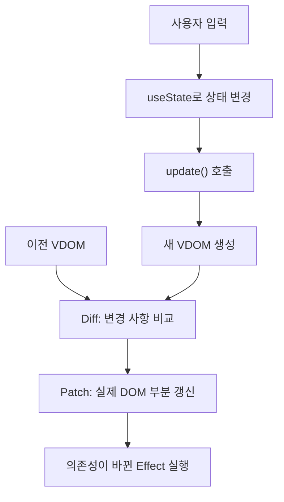

Mini React
===========

JavaScript로 Virtual DOM, Diff·Patch, 함수형 컴포넌트와 Hooks를 직접 구현한 프로젝트입니다.

사용자 입력으로 상태가 바뀌면 새 Virtual DOM과 이전 Virtual DOM을 비교해 변경 사항을 실제 DOM에 반영합니다.
외부 프레임워크 없이 컴포넌트 실행부터 상태 유지, 화면 갱신까지 연결했습니다.

## 동작 구조

- 상태는 `hooks` 배열에 저장하고, `update()`가 루트와 자식 컴포넌트를 실행해 새 VDOM을 만듭니다.
- 이전 VDOM과 비교한 변경 목록을 실제 DOM에 적용하며, 유지할 DOM 노드는 재사용합니다.
- 갱신한 VDOM은 다음 비교의 기준으로 저장하고, DOM 반영 후 의존성이 바뀐 Effect를 실행합니다.

## Virtual DOM · Diff · Patch

`createElement()`가 태그, 속성, 자식, 이벤트, 입력 프로퍼티를 가진 Virtual DOM을 생성합니다.
Diff는 두 트리의 차이를 변경 목록으로 만들고, Patch는 해당 목록을 실제 DOM에 적용합니다.

### Diff의 5가지 기본 경우

같은 위치의 두 노드를 비교하고, 자식도 같은 방식으로 재귀적으로 비교합니다.
값이 같으면 변경 목록을 만들지 않고, 차이가 있으면 다음 기준으로 처리합니다.

| 경우 | 판단 기준 | 변경 목록 |
| --- | --- | --- |
| 추가 | 이전 노드가 없고 다음 노드가 있음 | `ADD` |
| 삭제 | 이전 노드가 있고 다음 노드가 없음 | `REMOVE` |
| 교체 | 태그나 노드 종류가 달라짐 | `REPLACE` |
| 텍스트 변경 | 같은 위치의 텍스트 내용이 달라짐 | `TEXT` |
| 속성 변경 | 속성이 추가·삭제되거나 값이 달라짐 | `SET_PROP`, `REMOVE_PROP` |

### 변경 목록을 실제 DOM에 반영

Patch는 경로에 해당하는 DOM을 찾아 추가·삭제·교체 메서드나 `nodeValue`, `setAttribute()` 등을 적용합니다.

- 같은 인덱스의 자식끼리 재귀적으로 비교하며, 교체 대상이 아닌 기존 DOM 노드를 재사용합니다.
- 여러 형제 노드를 삭제할 때 인덱스가 밀리지 않도록 변경 전에 대상 DOM을 찾아 둡니다.
- 이전 이벤트 함수를 제거한 뒤 새 함수를 등록해 중복 등록을 방지합니다.
- DOM 프로퍼티는 구조와 속성 변경이 끝난 뒤 반영합니다. 같은 입력값은 재대입하지 않아 불필요한 커서 이동을 줄입니다.

구현: [diffVirtualDOM.js](virtualDOM/diffVirtualDOM.js), [patchDOM.js](virtualDOM/patchDOM.js)

## 함수형 컴포넌트와 상태 분리

- UI를 역할에 따라 작은 함수형 컴포넌트로 나눕니다.
- 루트 컴포넌트에서 상태를 관리합니다.
- 자식 컴포넌트는 전달받은 props로 Virtual DOM을 반환합니다.
- 부모가 상태 변경 함수를 props로 전달하고, 자식은 사용자 입력을 그 함수에 전달합니다.
- `createElement()`로 실행한 자식 컴포넌트에서는 Hook 호출을 차단합니다.

구현: [components.js](virtualDOM/components.js), [createElement.js](virtualDOM/createElement.js)

## 함수를 다시 실행해도 유지되는 상태

- `FunctionComponent` 인스턴스에 `hooks` 배열을 보관합니다.
- 렌더링을 시작할 때 Hook 인덱스를 0으로 초기화하고, 호출 순서대로 기존 저장 공간을 사용합니다.
- 루트 컴포넌트 함수가 다시 실행되어도 같은 인스턴스의 상태를 읽습니다.
- 렌더링 간 Hook 호출 개수나 종류의 순서가 달라지면 오류를 발생시킵니다.

구현: [FunctionComponent.js](virtualDOM/FunctionComponent.js), [hooks.js](virtualDOM/hooks.js)

## useState · useEffect · useMemo

세 Hook은 `getHook()`으로 자신의 저장 공간을 찾습니다.
컴포넌트 함수가 다시 실행되어도 같은 호출 순서의 저장 공간을 사용하므로 상태와 계산 결과가 유지됩니다.

### useState — 상태 저장과 화면 갱신

현재 상태와 상태를 바꾸는 함수를 함께 반환합니다.
변경 함수에서는 전달받은 값 또는 이전 상태로 계산한 값을 저장합니다.

- 값이 같으면 추가 갱신을 생략합니다.
- 값이 달라지면 상태를 저장하고 `scheduleUpdate()`를 통해 `update()`가 실행되도록 합니다.
- 다음 렌더링에서는 `hooks`에 저장한 새 상태를 읽습니다.

### useEffect — 화면 반영 후 작업 실행

의존성이 바뀌었는지 확인하고, 실행할 함수를 저장합니다.

저장한 함수는 DOM 반영 후 `flushEffects()`에서 실행합니다.

- 의존성을 생략하면 매 렌더링 후 실행하고, 빈 배열이면 최초 마운트 후 실행합니다.
- 의존성 배열에 값이 있으면 해당 값이 달라질 때 다시 실행합니다.
- Effect가 반환한 정리 함수는 보관했다가 다음 실행 전이나 컴포넌트 종료 시 호출합니다.

### useMemo — 계산 결과 재사용

최초 실행이거나 의존성이 바뀌었을 때만 계산하고 결과를 저장합니다.

의존성이 같으면 저장한 결과를 그대로 반환합니다.
`useEffect`가 실행할 작업과 정리 함수를 관리한다면, `useMemo`는 렌더링 중 사용할 계산 결과를 관리합니다.
의존성의 각 값은 `Object.is()`로 비교하며, `withoutHooks()`는 콜백 안에서 Hook을 호출하지 못하게 합니다.

구현: [hooks.js](virtualDOM/hooks.js), [FunctionComponent.js](virtualDOM/FunctionComponent.js)

## 검증

브라우저 수동 검증 항목과 확인 방법입니다.

| 검증 항목 | 확인 방법 | 결과 |
| --- | --- | --- |
| 상태 유지 | 화면이 다시 렌더링되어도 변경한 상태가 유지되는지 확인 | 확인 |
| 자동 화면 갱신 | 상태 변경 후 화면에 새 값이 반영되는지 확인 | 확인 |
| 부분 업데이트 | 개발자 도구에서 변경되지 않은 DOM 노드가 유지되는지 확인 | 확인 |
| useEffect | 의존성이 바뀔 때 실행되고 이전 정리 함수가 호출되는지 확인 | 확인 |
| useMemo | 의존성이 같을 때 계산 함수를 다시 실행하지 않는지 확인 | 확인 |
| Diff·Patch | 노드 추가·삭제·교체, 텍스트·속성 변경이 반영되는지 확인 | 확인 |

### 오류를 찾기 위한 사용자 행동

정상적인 사용뿐 아니라 빠른 조작, 빈 입력, 긴 입력 등으로 오류를 찾기 위한 케이스입니다.
아래 항목은 검증 방법을 정의한 것이며, 아직 실행하지 않았습니다.

| ID | 시도할 행동 | 정상으로 판단할 기준 | 결과 |
| --- | --- | --- | --- |
| E-01 | 증가 버튼을 빠르게 50번 누른다. | 처음 값에서 정확히 50만큼 증가하고, 증가가 누락되거나 중복되지 않는다. | 미확인 |
| E-02 | 입력 내용을 바꾼 직후 곧바로 증가 버튼을 누른다. | 입력한 값과 증가한 값이 모두 유지되며 서로의 상태를 덮어쓰지 않는다. | 미확인 |
| E-03 | 입력 내용을 전부 지운 뒤 다시 입력한다. | 빈 입력에서도 오류가 없고, 이전 내용이 되살아나거나 새 입력이 누락되지 않는다. | 미확인 |
| E-04 | 문자열 중간에 커서를 놓고 글자를 삽입·삭제한다. | 입력 중 포커스가 사라지거나 커서가 임의로 끝으로 이동하지 않는다. | 미확인 |
| E-05 | 한글을 빠르게 입력하면서 조합 중 글자를 지우고 다시 입력한다. | 조합 중인 글자가 끊기거나 중복되지 않고, 입력창과 화면에 표시된 최종 값이 일치한다. | 미확인 |
| E-06 | 이모지·특수문자·HTML 태그처럼 보이는 문자열을 붙여 넣는다. | 입력이 글자로 표시되고, HTML 요소로 실행되거나 문자가 손실되지 않는다. | 미확인 |
| E-07 | 1만 자를 붙여 넣은 뒤 전체 선택·삭제·짧은 값 입력을 반복한다. | 페이지가 멈추거나 오류가 발생하지 않고, 마지막 입력값이 반영된다. 긴 문자열의 화면 넘침도 확인한다. | 미확인 |
| E-08 | 입력을 여러 번 바꾼 뒤 실행 취소·다시 실행을 반복한다. | 입력창의 현재 값과 화면에 표시된 값이 어긋나지 않는다. | 미확인 |
| E-09 | 입력 변경과 버튼 클릭을 반복해 30번 이상 갱신한 뒤 버튼을 한 번 더 누른다. | 마지막 한 번의 클릭이 정확히 한 번만 처리되어 이벤트 중복 등록이 없다. | 미확인 |
| E-10 | 마우스 없이 Tab으로 이동하고 Enter·Space로 버튼을 조작한다. | 입력창을 사용할 수 있고, 버튼 활성화 한 번에 상태 변경이 한 번만 발생한다. | 미확인 |

실패한 경우에는 재현 순서, 입력값, 기대한 결과와 실제 결과, 콘솔 오류를 함께 기록합니다.

## 중점 포인트

### 브라우저에서 DOM을 다루는 방법

브라우저에서 DOM을 다룰 때는 **문서가 준비되는 시점**과 **화면을 표시할 위치**를 알아야 합니다.

- **Window**를 통해 HTML을 읽고 DOM 구성이 끝나는 시점을 확인합니다.
- **Document**를 통해 현재 문서에서 화면을 표시할 요소를 찾습니다.
- 찾은 요소에 새 DOM을 붙여 화면을 표시합니다.

#### 실제 DOM의 변경 감지

`MutationObserver`는 자식 노드 추가·삭제, 속성, 텍스트 변경을 관찰하는 브라우저 API입니다.
`childList`, `attributes`, `characterData`, `subtree` 등의 옵션으로 관찰 범위를 지정합니다.
입력창의 현재 `value` 같은 프로퍼티 변경은 DOM 속성 변경과 구분하고, 사용자 입력은 `input`·`change` 이벤트로 처리합니다.
API 설명: [MutationObserver](https://developer.mozilla.org/en-US/docs/Web/API/MutationObserver).

현재 구현은 상태 변경을 출발점으로 Diff·Patch를 실행하며, `MutationObserver`를 사용하지 않습니다.
DOM 변경 감지와 다음 화면의 변경 사항을 계산하는 Diff는 서로 다른 역할입니다.

#### Reflow · Repaint와 DOM 갱신 비용

- **Reflow**: 요소의 크기와 위치를 다시 계산하는 작업입니다.
- **Repaint**: 글자나 색상 등을 화면에 다시 그리는 작업입니다.

DOM을 변경하면 이런 작업이 필요할 수 있습니다.
이 프로젝트는 기존 DOM을 재사용하고 달라진 부분만 수정해 불필요한 작업을 줄입니다.
렌더링 과정: [MDN — Critical rendering path](https://developer.mozilla.org/en-US/docs/Web/Performance/Guides/Critical_rendering_path).
