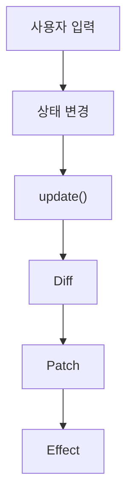

# Mini React

JavaScript로 Virtual DOM, Diff·Patch, 함수형 컴포넌트와 Hooks를 직접 구현한 프로젝트입니다.

## 동작 구조

- 상태가 바뀌면 컴포넌트를 다시 실행해 새 Virtual DOM을 만듭니다.
- 이전 Virtual DOM과 비교해 바뀐 부분만 실제 DOM에 반영합니다.
- 반영이 끝나면 `useEffect` 작업을 실행합니다.

## Virtual DOM · Diff · Patch

`createElement()`로 만든 Virtual DOM을 이전 것과 비교하고, 변경 목록만 실제 DOM에 적용합니다.

소스: [createElement.js](virtualDOM/createElement.js) · [diffVirtualDOM.js](virtualDOM/diffVirtualDOM.js) · [patchDOM.js](virtualDOM/patchDOM.js)

### Diff의 5가지 기본 경우

| 경우 | 판단 기준 | 변경 목록 |
|---|---|---|
| 추가 | 새 노드만 있음 | `ADD` |
| 삭제 | 이전 노드만 있음 | `REMOVE` |
| 교체 | 태그가 다름 | `REPLACE` |
| 텍스트 변경 | 글자가 다름 | `TEXT` |
| 속성 변경 | 속성이 추가·삭제되거나 값이 다름 | `SET_PROP`, `REMOVE_PROP` |

이벤트 변경과 입력값 변경은 각각 `SET_EVENT`, `SET_DOM_PROP`로 처리합니다.

### 변경 목록을 실제 DOM에 반영

- 변경 목록에 없는 노드는 기존 DOM을 그대로 사용합니다.
- 이벤트는 이전 함수를 떼고 새 함수를 붙여 중복 실행을 막습니다.
- 입력창 `value`는 프로퍼티에 직접 넣어 실제 값이 바뀌게 합니다.

## 함수형 컴포넌트와 상태 분리

- 상태와 Hook은 루트 컴포넌트에서만 사용합니다.
- 자식 컴포넌트는 props로 받은 값으로 Virtual DOM만 반환합니다.
- `FunctionComponent`가 루트를 감싸 `mount()`와 `update()`를 담당합니다.

소스: [FunctionComponent.js](virtualDOM/FunctionComponent.js)

## 함수를 다시 실행해도 유지되는 상태

- 상태는 함수 밖, `FunctionComponent`의 `hooks` 배열에 저장합니다.
- `render()`마다 `hookIndex`를 0으로 되돌리고, Hook은 호출 순서대로 같은 칸을 사용합니다.

소스: [hooks.js](virtualDOM/hooks.js)

## useState · useEffect · useMemo

### useState — 상태 저장과 화면 갱신

- `setState`가 자기 칸에 새 값을 저장하고 화면이 갱신되도록 연결합니다.
- 이전 값과 같으면 다시 그리지 않습니다.

### useEffect — 화면 반영 후 작업 실행

- 최초 실행이거나 의존성이 바뀌면 실행할 작업을 Hook에 저장합니다.
- Patch가 끝난 뒤 `flushEffects()`로 실행하고, 다시 실행하기 전에는 이전 정리 함수를 호출합니다.

### useMemo — 계산 결과 재사용

- 계산 결과와 의존성을 함께 저장합니다.
- 의존성이 바뀌었을 때만 다시 계산합니다.

## 설계 정책

프레임워크 사용자가 결과를 예측할 수 있도록 허용 범위와 동작 기준을 정합니다.

| 항목 | 현재 적용한 기준 |
|---|---|
| 상태의 소유자 | 상태와 Hook은 루트에서 관리하고, 자식은 props만 사용합니다. |
| 상태 변경 판단 | `Object.is()`로 같은 값이면 갱신을 생략합니다. 객체·배열을 바꿀 때는 새 참조를 전달합니다. |
| 화면 갱신 시점 | 상태는 setter에서 저장하고, 화면 갱신은 마이크로태스크에서 처리합니다. |
| Hook 사용 규칙 | 루트의 최상위에서 같은 순서로 호출합니다. 자식은 `createElement()`를 통해 실행하며 Hook을 사용할 수 없습니다. |
| 노드의 동일성 | 같은 인덱스의 자식끼리 비교합니다. `key`를 기준으로 노드를 이동하는 기능은 지원하지 않습니다. |
| 입력값 처리 | 입력값은 HTML 속성과 구분해 DOM 프로퍼티에 반영합니다. 같은 값은 재대입하지 않습니다. |
| Effect·이벤트 정리 | Effect 재실행 전과 종료 시 정리 함수를 호출합니다. 이벤트 교체 시 이전 함수를 제거합니다. |
| 오류 처리 | 잘못된 Hook 호출이나 함수가 아닌 이벤트 등록은 오류로 알립니다. 종료 중 정리 함수에서 발생한 오류는 기록하고 나머지 정리를 계속합니다. |

렌더링·Patch 실패 시 화면 복구 방식과 입력 길이 제한은 아직 정하지 않았습니다.
Hook 호출 개수·종류의 순서 검사, 입력 커서·한글 조합 유지 등 경계 상황도 정책에 맞게 검증해야 합니다.

## 검증

브라우저 수동 검증 항목과 확인 방법입니다.

| 검증 항목 | 확인 방법 | 결과 |
| --- | --- | --- |
| 상태 유지 | 화면이 다시 렌더링되어도 변경한 상태가 유지되는지 확인 | 확인 |
| 자동 화면 갱신 | 상태 변경 후 화면에 새 값이 반영되는지 확인 | 확인 |
| 부분 업데이트 | 개발자 도구에서 변경되지 않은 DOM 노드가 유지되는지 확인 | 확인 |
| useEffect | 의존성이 바뀔 때 실행되고 이전 정리 함수가 호출되는지 확인 | 확인 |
| useMemo | 의존성이 같을 때 계산 함수를 다시 실행하지 않는지 확인 | 확인 |
| Diff·Patch | 노드 추가·삭제·교체, 텍스트·속성 변경이 반영되는지 확인 | 확인 |

### 오류를 찾기 위한 사용자 행동

연속 클릭, 한글 조합 입력, 긴 문자열 입력으로 오류를 찾는 대표 케이스입니다.
아래 항목은 검증 방법을 정의한 것이며, 아직 실행하지 않았습니다.

| ID | 시도할 행동 | 정상으로 판단할 기준 | 결과 |
| --- | --- | --- | --- |
| E-01 | 증가 버튼을 빠르게 50번 누른다. | 처음 값에서 정확히 50만큼 증가하고, 증가가 누락되거나 중복되지 않는다. | 미확인 |
| E-02 | 한글을 빠르게 입력하면서 조합 중 글자를 지우고 다시 입력한다. | 조합 중인 글자가 끊기거나 중복되지 않고, 입력창과 화면에 표시된 최종 값이 일치한다. | 미확인 |
| E-03 | 1만 자를 붙여 넣은 뒤 전체 선택·삭제·짧은 값 입력을 반복한다. | 페이지가 멈추거나 오류가 발생하지 않고, 마지막 입력값이 반영된다. 긴 문자열의 화면 넘침도 확인한다. | 미확인 |

실패한 경우에는 재현 순서, 입력값, 기대한 결과와 실제 결과, 콘솔 오류를 함께 기록합니다.

## 중점 포인트

### 브라우저에서 DOM을 다루는 방법

- Window로 문서 준비 시점을 확인하고, Document로 화면을 표시할 위치를 찾습니다.
- `createElement()`, `appendChild()`, `nodeValue`, `replaceChild()`, `removeChild()` 등으로 실제 DOM을 만들고 수정합니다.
- 실제 DOM 생성·수정은 `patchDOM.js`와 `FunctionComponent.js`에서 처리하고, 컴포넌트는 Virtual DOM을 반환합니다.

#### 실제 DOM의 변경 감지

- 브라우저는 [`MutationObserver`](https://developer.mozilla.org/ko/docs/Web/API/MutationObserver)로 DOM 변경을 감지할 수 있습니다.
- 현재 구현은 사용하지 않고, `setState` 호출로 변경을 알아챕니다.

#### Reflow · Repaint와 DOM 갱신 비용

- DOM 변경 내용에 따라 크기·위치를 다시 계산하는 Reflow와 화면을 다시 그리는 Repaint가 필요할 수 있습니다. ([참고](https://developer.mozilla.org/en-US/docs/Web/Performance/Guides/Critical_rendering_path))
- 그래서 비교는 Virtual DOM으로 하고, 실제 DOM은 바뀐 노드만 수정합니다.
