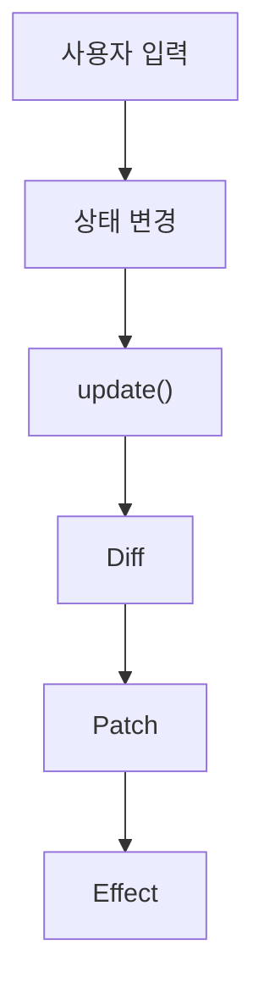

# Mini React

JavaScript로 Virtual DOM, Diff·Patch, 함수형 컴포넌트와 Hooks를 직접 구현한 프로젝트입니다.

## 동작 구조



- 상태가 바뀌면 컴포넌트를 다시 실행해 새 Virtual DOM을 만듭니다.
- 이전 Virtual DOM과 비교해 바뀐 부분만 실제 DOM에 반영합니다.
- 반영이 끝나면 `useEffect` 작업을 실행합니다.

| 단계 | 범위 | 확인 페이지 |
|---|---|---|
| Phase 1 | Virtual DOM · Diff · Patch | `index.html` |
| Phase 2 | 함수형 컴포넌트 · State · Hooks | `phase2.html`, `roulette.html` |

## Virtual DOM · Diff · Patch

소스: [`vdom.js`](./vdom.js) · [`diff.js`](./diff.js) · [`patch.js`](./patch.js)

### diff

```js
const patches = diff(이전VNode, 새VNode);
```

- 두 Virtual DOM을 비교해 바뀐 곳의 목록을 돌려줍니다.
- 실제 DOM은 건드리지 않습니다.

| 변경 | 언제 |
|---|---|
| `ADD` | 노드가 생김 |
| `REMOVE` | 노드가 사라짐 |
| `REPLACE` | 태그가 바뀜 |
| `TEXT` | 글자가 바뀜 |
| `PROPS` | 속성·이벤트가 바뀜 |

### patch

```js
patch(실제DOM, patches);
```

- `diff`가 만든 목록대로 실제 DOM의 바뀐 곳만 고칩니다.
- 목록에 없는 노드는 그대로 둡니다.

### Phase 1 검증 페이지

- 테스트 영역을 수정하고 **Patch**를 누르면 바뀐 부분만 실제 영역에 반영됩니다.
- **뒤로·앞으로** 버튼으로 이전 상태로 이동할 수 있습니다.

소스: [`index.html`](./index.html) · [`main.js`](./main.js)

## 함수형 컴포넌트와 상태 분리

- 상태와 Hook은 루트 컴포넌트에서만 사용합니다.
- 자식 컴포넌트는 props로 받은 값으로 Virtual DOM만 반환합니다.
- `FunctionComponent`가 루트를 감싸 `mount()`와 `update()`를 담당합니다.

```js
const app = new FunctionComponent(App);
app.mount(document.getElementById("app"));
```

소스: [`component.js`](./component.js)

## 함수를 다시 실행해도 유지되는 상태

- 상태는 함수 밖, `FunctionComponent`의 `hooks` 배열에 저장합니다.
- Hook은 호출 순서대로 같은 칸을 사용하므로, 조건문 안에서 호출하지 않습니다.

소스: [`hooks.js`](./hooks.js)

## useState · useEffect · useMemo

### useState

```js
const [값, 바꾸는함수] = useState(처음값);
```

- 값을 저장하고, 바꾸는 함수를 부르면 화면이 다시 그려집니다.
- 같은 값을 넣으면 다시 그리지 않습니다.

```js
const [count, setCount] = useState(0);   // 숫자
setCount(count + 1);                     // 숫자 1 올리기

const [name, setName] = useState("");    // 이름
setName("철수");                         // 이름 바꾸기
```

### useEffect

```js
useEffect(() => { 할 일 }, [의존성]);
```

- 화면을 다 그린 뒤에 실행됩니다.
- 의존성 값이 바뀔 때만 다시 실행됩니다.

```js
useEffect(() => {
  document.title = `숫자: ${count}`;     // count가 바뀔 때만 탭 제목 변경
}, [count]);
```

### useMemo

```js
const 결과 = useMemo(() => 계산, [의존성]);
```

- 의존성 값이 바뀔 때만 다시 계산하고, 아니면 이전 결과를 씁니다.

```js
const nameLength = useMemo(() => name.length, [name]);   // name이 바뀔 때만 글자 수 계산
```

## 검증

| 검증 항목 | 확인 방법 | 결과 |
|---|---|---|
| Diff·Patch | `index.html`에서 테스트 영역 수정 후 Patch 시 바뀐 부분만 실제 영역에 반영되는지 확인 | |
| History | 뒤로·앞으로 이동 시 두 영역이 함께 바뀌는지 확인 | |
| 상태 유지 | `phase2.html`에서 숫자를 올린 뒤 이름을 입력해도 숫자가 유지되는지 확인 | |
| 부분 업데이트 | `update 변경 목록`에 바뀐 노드만 나오는지 확인 | |
| useEffect | 의존성이 바뀔 때만 실행되고, Patch 이후에 실행되는지 확인 | |
| useMemo | 의존성이 바뀔 때만 다시 계산하는지 확인 | |

### 오류를 찾기 위한 사용자 행동

| ID | 시도할 행동 | 정상으로 판단할 기준 | 결과 |
|---|---|---|---|
| E-01 | `index.html` 테스트 영역의 내용을 모두 지우고 Patch | 오류 없이 알림만 표시됨 | 미확인 |
| E-02 | 뒤로 간 상태에서 새로 Patch | 그 뒤의 History가 지워지고 새 상태가 추가됨 | 미확인 |
| E-03 | 같은 값으로 `setState` 호출 | 화면을 다시 그리지 않음 | 미확인 |
| E-04 | 리스트 가운데 항목 삭제 | 화면 결과가 맞음 (뒤 항목은 변경으로 처리됨) | 미확인 |

## 중점 포인트

### 브라우저에서 DOM을 다루는 방법

- `createElement()`, `appendChild()`, `textContent`, `replaceWith()`, `remove()`로 DOM을 만들고 수정합니다.
- 이 작업은 `vdom.js`와 `patch.js`에서만 하고, 컴포넌트는 DOM을 직접 다루지 않습니다.

#### 실제 DOM의 변경 감지

- 브라우저는 [`MutationObserver`](https://developer.mozilla.org/ko/docs/Web/API/MutationObserver)로 DOM 변경을 감지할 수 있습니다.
- 현재 구현은 사용하지 않습니다. Phase 1은 Patch 버튼을 누를 때 DOM을 읽고, Phase 2는 `setState` 호출로 변경을 알아챕니다.

#### Reflow · Repaint와 DOM 갱신 비용

- DOM이 바뀌면 브라우저가 레이아웃을 다시 계산(Reflow)하고 다시 그립니다(Repaint). ([참고](https://developer.mozilla.org/ko/docs/Web/Performance/Critical_rendering_path))
- 그래서 비교는 Virtual DOM으로 하고, 실제 DOM은 바뀐 노드만 수정합니다.
