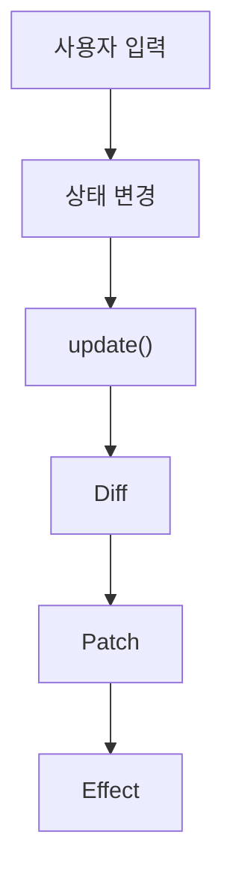

# Mini React

JavaScript로 Virtual DOM, Diff·Patch, 함수형 컴포넌트와 Hooks를 직접 구현한 프로젝트입니다.

## 동작 구조

- 상태가 바뀌면 컴포넌트를 다시 실행해 새 Virtual DOM을 만듭니다.
- 이전 Virtual DOM과 비교해 바뀐 부분만 실제 DOM에 반영합니다.
- 반영이 끝나면 `useEffect` 작업을 실행합니다.

## Virtual DOM · Diff · Patch

`h()`로 만든 Virtual DOM을 이전 것과 비교하고, 변경 목록만 실제 DOM에 적용합니다.

소스: [`vdom.js`](./vdom.js) · [`diff.js`](./diff.js) · [`patch.js`](./patch.js)

### Diff의 5가지 기본 경우

| 경우 | 판단 기준 | 변경 목록 |
|---|---|---|
| 추가 | 새 노드만 있음 | `ADD` |
| 삭제 | 이전 노드만 있음 | `REMOVE` |
| 교체 | 태그가 다름 | `REPLACE` |
| 텍스트 변경 | 글자가 다름 | `TEXT` |
| 속성 변경 | 속성·이벤트 값이 다름 | `PROPS` |

### 변경 목록을 실제 DOM에 반영

- 변경 목록에 없는 노드는 기존 DOM을 그대로 사용합니다.
- 이벤트는 이전 함수를 떼고 새 함수를 붙여 중복 실행을 막습니다.
- 입력창 `value`는 프로퍼티에 직접 넣어 실제 값이 바뀌게 합니다.

## 함수형 컴포넌트와 상태 분리

- 상태와 Hook은 루트 컴포넌트에서만 사용합니다.
- 자식 컴포넌트는 props로 받은 값으로 Virtual DOM만 반환합니다.
- `FunctionComponent`가 루트를 감싸 `mount()`와 `update()`를 담당합니다.

소스: [`component.js`](./component.js)

## 함수를 다시 실행해도 유지되는 상태

- 상태는 함수 밖, `FunctionComponent`의 `hooks` 배열에 저장합니다.
- `render()`마다 `hookIndex`를 0으로 되돌리고, Hook은 호출 순서대로 같은 칸을 사용합니다.

소스: [`hooks.js`](./hooks.js)

## useState · useEffect · useMemo

### useState — 상태 저장과 화면 갱신

- `setState`가 자기 칸에 새 값을 저장하고 `update()`를 호출합니다.
- 이전 값과 같으면 다시 그리지 않습니다.

### useEffect — 화면 반영 후 작업 실행

- 의존성이 바뀌었을 때만 작업을 `pendingEffects`에 모읍니다.
- Patch가 끝난 뒤 `runEffects()`로 실행합니다.

### useMemo — 계산 결과 재사용

- 계산 결과와 의존성을 함께 저장합니다.
- 의존성이 바뀌었을 때만 다시 계산합니다.

## 검증

| 검증 항목 | 확인 방법 | 결과 |
|---|---|---|
| 상태 유지 | 숫자를 올린 뒤 이름을 입력해도 숫자가 유지되는지 확인 | |
| 자동 화면 갱신 | `+1` 클릭, 이름 입력 시 화면이 바로 바뀌는지 확인 | |
| 부분 업데이트 | `update 변경 목록`에 바뀐 노드만 나오는지 확인 | |
| useEffect | 숫자가 바뀔 때만 탭 제목이 바뀌는지 확인 | |
| useMemo | 이름이 바뀔 때만 글자 수를 다시 계산하는지 확인 | |
| Diff·Patch | 클릭 1회에 숫자가 1씩만 오르는지 확인 | |

### 오류를 찾기 위한 사용자 행동

| ID | 시도할 행동 | 정상으로 판단할 기준 | 결과 |
|---|---|---|---|
| E-01 | `+1`을 빠르게 여러 번 클릭 | 누른 횟수만큼만 숫자가 오름 | 미확인 |
| E-02 | 숫자가 0일 때 `초기화` 클릭 | 화면을 다시 그리지 않음 | 미확인 |
| E-03 | 입력창의 이름을 모두 지움 | `안녕, 누구!`, 글자 수 0으로 돌아옴 | 미확인 |

## 중점 포인트

### 브라우저에서 DOM을 다루는 방법

- `createElement()`, `appendChild()`, `textContent`, `replaceWith()`, `remove()`로 DOM을 만들고 수정합니다.
- 이 작업은 `vdom.js`와 `patch.js`에서만 하고, 컴포넌트는 DOM을 직접 다루지 않습니다.

#### 실제 DOM의 변경 감지

- 브라우저는 [`MutationObserver`](https://developer.mozilla.org/ko/docs/Web/API/MutationObserver)로 DOM 변경을 감지할 수 있습니다.
- 현재 구현은 사용하지 않고, `setState` 호출로 변경을 알아챕니다.

#### Reflow · Repaint와 DOM 갱신 비용

- DOM이 바뀌면 브라우저가 레이아웃을 다시 계산(Reflow)하고 다시 그립니다(Repaint). ([참고](https://developer.mozilla.org/ko/docs/Web/Performance/Critical_rendering_path))
- 그래서 비교는 Virtual DOM으로 하고, 실제 DOM은 바뀐 노드만 수정합니다.
