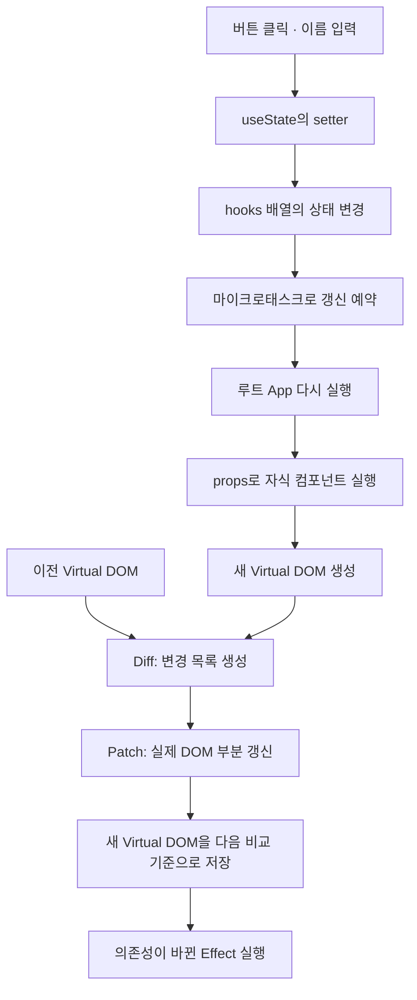

Mini React
===========

JavaScript로 Virtual DOM, Diff·Patch, 함수형 컴포넌트와 Hooks를 직접 구현한 프로젝트입니다.

사용자가 버튼을 누르거나 이름을 입력하면 상태가 바뀌고, 새 Virtual DOM과 이전 Virtual DOM을 비교해 변경 사항을 실제 DOM에 반영합니다.
외부 프레임워크 없이 컴포넌트 실행부터 상태 유지, 화면 갱신까지 연결했습니다.

## 주요 기능

| 기능 | 화면 동작 |
| --- | --- |
| 숫자 증가 | `+1` 버튼을 누르면 숫자가 1씩 증가합니다. |
| 이름 입력 | 입력한 이름에 맞춰 인사말이 바뀝니다. |
| 탭 제목 갱신 | 이름과 숫자가 바뀌면 브라우저 탭 제목에도 반영됩니다. |

## 동작 구조



최초 실행은 `mount()`에서 DOM을 생성해 화면에 붙입니다.
이후 상태 변경은 `update()`에서 기존 DOM에 변경 목록을 적용합니다.

## 함수형 컴포넌트와 상태 분리

- 루트 `App`에서 숫자와 이름 상태를 관리합니다.
- 자식 `Counter`, `NameInput`은 전달받은 props로 Virtual DOM을 반환합니다.
- 부모가 상태 변경 함수를 props로 전달하고, 자식은 사용자 입력을 그 함수에 전달합니다.
- `createElement()`로 실행한 자식 컴포넌트에서는 Hook 호출을 차단합니다.

```text
App — count, name 상태 관리
├─ NameInput — name과 입력 처리 함수 전달
└─ Counter   — count와 증가 처리 함수 전달
```

구현: [components.js](virtualDOM/components.js), [createElement.js](virtualDOM/createElement.js)

## 함수를 다시 실행해도 유지되는 상태

- `FunctionComponent` 인스턴스에 `hooks` 배열을 보관합니다.
- 렌더링을 시작할 때 Hook 인덱스를 0으로 초기화하고, 호출 순서대로 기존 저장 공간을 사용합니다.
- `App` 함수가 다시 실행되어도 같은 인스턴스의 상태를 읽습니다.
- 렌더링 간 Hook 호출 개수나 종류의 순서가 달라지면 오류를 발생시킵니다.

구현: [FunctionComponent.js](virtualDOM/FunctionComponent.js), [hooks.js](virtualDOM/hooks.js)

## useState — 상태 변경과 자동 갱신

- 초기값과 지연 초기화 함수를 지원합니다.
- `setCount(1)`과 `setCount(value => value + 1)` 형태의 갱신을 지원합니다.
- `Object.is()`로 값이 같으면 추가 갱신을 생략합니다.
- 상태가 바뀌면 화면 갱신을 예약합니다. 이미 예약된 갱신이 있으면 추가 예약을 생략해 같은 이벤트 안의 여러 상태 변경을 모읍니다.
- 컴포넌트 종료 시 예약된 갱신을 무효화하고, 이전 인스턴스 생명주기의 setter 호출을 무시합니다.

## useEffect — DOM 반영 후 실행과 정리

- 의존성 배열의 각 값을 `Object.is()`로 비교합니다.
- 빈 배열은 최초 마운트 후 실행하고, 의존성을 생략하면 매 렌더링 후 실행합니다.
- 의존성이 바뀌면 이전 정리 함수를 호출한 뒤 새 Effect를 실행합니다.
- `unmount()`에서도 정리 함수를 실행합니다.

예제에서는 이름과 숫자에 맞춰 `document.title`을 바꾸고, 정리 함수에서 이전 제목을 복원합니다.
이 구현의 Effect는 DOM 반영 직후 동기적으로 실행합니다.

## useMemo — 의존성에 따른 결과 재사용

- 계산 결과와 의존성 배열을 `hooks`에 저장합니다.
- 의존성이 같으면 저장된 결과를 반환하고, 바뀌면 다시 계산합니다.
- 예제에서는 이름으로 인사말을 만듭니다. 숫자만 증가할 때는 기존 인사말을 재사용합니다.

세 Hook의 구현: [hooks.js](virtualDOM/hooks.js)

## Virtual DOM · Diff · Patch

`createElement()`가 태그, 속성, 자식, 이벤트, 입력 프로퍼티를 가진 Virtual DOM을 생성합니다.
Diff는 두 트리의 차이를 변경 목록으로 만들고, Patch는 해당 목록을 실제 DOM에 적용합니다.

| 변경 종류 | 처리 |
| --- | --- |
| `ADD` / `REMOVE` | 노드 추가·삭제 |
| `REPLACE` | 태그 또는 노드 종류가 달라진 위치 교체 |
| `TEXT` | 텍스트·주석 내용 변경 |
| `SET_PROP` / `REMOVE_PROP` | HTML 속성 설정·삭제 |
| `SET_EVENT` | 이벤트 함수 등록·교체·제거 |
| `SET_DOM_PROP` | `value`, `checked` 등 DOM 프로퍼티 반영 |

- 같은 인덱스의 자식끼리 재귀적으로 비교하며, 교체 대상이 아닌 기존 DOM 노드를 재사용합니다.
- 여러 형제 노드를 삭제할 때 인덱스가 밀리지 않도록 변경 전에 대상 DOM을 찾아 둡니다.
- 이전 이벤트 함수를 제거한 뒤 새 함수를 등록해 중복 등록을 방지합니다.
- DOM 프로퍼티는 구조와 속성 변경이 끝난 뒤 반영합니다. 같은 입력값은 재대입하지 않아 불필요한 커서 이동을 줄입니다.

구현: [diffVirtualDOM.js](virtualDOM/diffVirtualDOM.js), [patchDOM.js](virtualDOM/patchDOM.js)

## 파일 구성

```text
virtualDOM/
├─ virtualDOM.html       # 실행 페이지와 루트 마운트
├─ components.js         # App, Counter, NameInput
├─ FunctionComponent.js  # 렌더링·Hook 저장 공간·생명주기 관리
├─ hooks.js              # useState, useEffect, useMemo
├─ createElement.js      # Virtual DOM 생성과 자식 함수 실행
├─ diffVirtualDOM.js     # 변경 목록 계산
└─ patchDOM.js           # 실제 DOM 생성과 부분 갱신
```

## 실행 방법

1. 저장소를 내려받습니다.
2. [virtualDOM/virtualDOM.html](virtualDOM/virtualDOM.html)을 브라우저에서 엽니다.
3. `+1` 버튼과 이름 입력으로 화면과 탭 제목의 변경을 확인합니다.

별도의 패키지 설치나 빌드 과정은 필요하지 않습니다.

## 구현 범위

상태와 Hook은 루트에서 관리하고 자식은 props만 사용하는 학습용 구현입니다.
자식 비교는 인덱스를 기준으로 하며, key 기반 재정렬과 동시성 렌더링은 구현하지 않았습니다.
현재 화면은 Phase 2 예제로 구성하고, 기존 Diff·Patch 로직을 렌더링에 재사용합니다.
