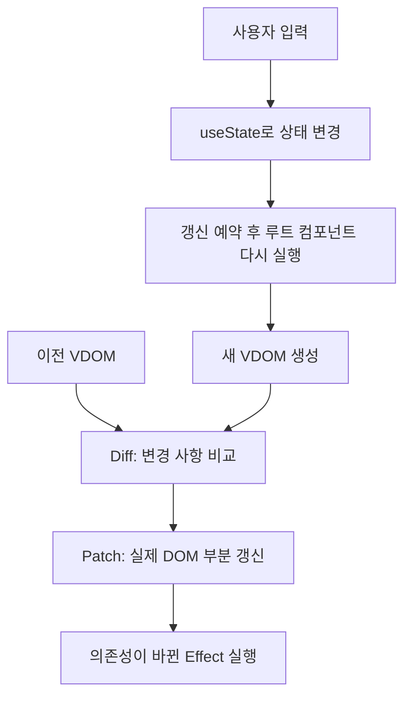

Mini React
===========

JavaScript로 Virtual DOM, Diff·Patch, 함수형 컴포넌트와 Hooks를 직접 구현한 프로젝트입니다.

사용자 입력으로 상태가 바뀌면 새 Virtual DOM과 이전 Virtual DOM을 비교해 변경 사항을 실제 DOM에 반영합니다.
외부 프레임워크 없이 컴포넌트 실행부터 상태 유지, 화면 갱신까지 연결했습니다.

## 동작 구조



- 상태는 `hooks` 배열에 저장하고, 갱신이 예약되면 루트와 자식 컴포넌트를 실행해 새 VDOM을 만듭니다.
- 이전 VDOM과 비교한 변경 목록을 실제 DOM에 적용하며, 유지할 DOM 노드는 재사용합니다.
- 갱신한 VDOM은 다음 비교의 기준으로 저장하고, DOM 반영 후 의존성이 바뀐 Effect를 실행합니다.

## 브라우저에서 DOM을 다루는 방법

DOM은 HTML 요소와 글자를 JavaScript로 다룰 수 있게 만든 구조입니다.

- **window**: 브라우저 환경으로, 문서 로딩 등의 이벤트를 받습니다.
- **document**: 현재 문서에서 요소를 찾거나 새 요소를 만듭니다.
- **DOM 노드**: 요소나 텍스트를 나타내며, 추가·수정·삭제하면 화면에 반영됩니다.

mini-react는 이 기능들을 사용해 VDOM의 변경 사항을 실제 화면에 반영합니다.

### 실제 DOM의 변경 감지

`MutationObserver`는 자식 노드 추가·삭제, 속성, 텍스트 변경을 관찰하는 브라우저 API입니다.
`childList`, `attributes`, `characterData`, `subtree` 등의 옵션으로 관찰 범위를 지정합니다.
입력창의 현재 `value` 같은 프로퍼티 변경은 DOM 속성 변경과 구분하고, 사용자 입력은 `input`·`change` 이벤트로 처리합니다.
API 설명: [MutationObserver](https://developer.mozilla.org/en-US/docs/Web/API/MutationObserver).

현재 구현은 상태 변경을 출발점으로 Diff·Patch를 실행하며, `MutationObserver`를 사용하지 않습니다.
DOM 변경 감지와 다음 화면의 변경 사항을 계산하는 Diff는 서로 다른 역할입니다.

### Reflow · Repaint와 DOM 갱신 비용

- **Reflow**: 요소의 크기와 위치를 다시 계산하는 작업입니다.
- **Repaint**: 글자나 색상 등을 화면에 다시 그리는 작업입니다.

DOM을 변경하면 이런 작업이 필요할 수 있습니다.
이 프로젝트는 기존 DOM을 재사용하고 달라진 부분만 수정해 불필요한 작업을 줄입니다.
렌더링 과정: [MDN — Critical rendering path](https://developer.mozilla.org/en-US/docs/Web/Performance/Guides/Critical_rendering_path).

## Virtual DOM · Diff · Patch

`createElement()`가 태그, 속성, 자식, 이벤트, 입력 프로퍼티를 가진 Virtual DOM을 생성합니다.
Diff는 두 트리의 차이를 변경 목록으로 만들고, Patch는 해당 목록을 실제 DOM에 적용합니다.

### Diff의 5가지 기본 경우

같은 위치의 두 노드를 비교하고, 자식도 같은 방식으로 재귀적으로 비교합니다.
값이 같으면 변경 목록을 만들지 않고, 차이가 있으면 다음 기준으로 처리합니다.

| 경우 | 판단 기준 | 변경 목록 |
| --- | --- | --- |
| 추가 | 이전 노드가 없고 다음 노드가 있음 | `ADD` |
| 삭제 | 이전 노드가 있고 다음 노드가 없음 | `REMOVE` |
| 교체 | 태그나 노드 종류가 달라짐 | `REPLACE` |
| 텍스트 변경 | 같은 위치의 텍스트 내용이 달라짐 | `TEXT` |
| 속성 변경 | 속성이 추가·삭제되거나 값이 달라짐 | `SET_PROP`, `REMOVE_PROP` |

### 변경 목록을 실제 DOM에 반영

Patch는 경로에 해당하는 DOM을 찾아 추가·삭제·교체 메서드나 `nodeValue`, `setAttribute()` 등을 적용합니다.

- 같은 인덱스의 자식끼리 재귀적으로 비교하며, 교체 대상이 아닌 기존 DOM 노드를 재사용합니다.
- 여러 형제 노드를 삭제할 때 인덱스가 밀리지 않도록 변경 전에 대상 DOM을 찾아 둡니다.
- 이전 이벤트 함수를 제거한 뒤 새 함수를 등록해 중복 등록을 방지합니다.
- DOM 프로퍼티는 구조와 속성 변경이 끝난 뒤 반영합니다. 같은 입력값은 재대입하지 않아 불필요한 커서 이동을 줄입니다.

구현: [diffVirtualDOM.js](virtualDOM/diffVirtualDOM.js), [patchDOM.js](virtualDOM/patchDOM.js)

## 함수형 컴포넌트와 상태 분리

- UI를 역할에 따라 작은 함수형 컴포넌트로 나눕니다.
- 루트 컴포넌트에서 상태를 관리합니다.
- 자식 컴포넌트는 전달받은 props로 Virtual DOM을 반환합니다.
- 부모가 상태 변경 함수를 props로 전달하고, 자식은 사용자 입력을 그 함수에 전달합니다.
- `createElement()`로 실행한 자식 컴포넌트에서는 Hook 호출을 차단합니다.

구현: [components.js](virtualDOM/components.js), [createElement.js](virtualDOM/createElement.js)

## 함수를 다시 실행해도 유지되는 상태

- `FunctionComponent` 인스턴스에 `hooks` 배열을 보관합니다.
- 렌더링을 시작할 때 Hook 인덱스를 0으로 초기화하고, 호출 순서대로 기존 저장 공간을 사용합니다.
- 루트 컴포넌트 함수가 다시 실행되어도 같은 인스턴스의 상태를 읽습니다.
- 렌더링 간 Hook 호출 개수나 종류의 순서가 달라지면 오류를 발생시킵니다.

구현: [FunctionComponent.js](virtualDOM/FunctionComponent.js), [hooks.js](virtualDOM/hooks.js)

## 실제 React와의 동작 비교

두 구현 모두 렌더링 결과를 비교해 실제 DOM의 변경된 부분을 갱신합니다.

| 항목 | 이 프로젝트 | React |
| --- | --- | --- |
| 상태 관리 | 루트에서만 상태·Hook 사용 | 각 함수형 컴포넌트에서 사용 가능 |
| 자식 비교 | 인덱스 기준 | 타입·위치·목록의 `key` 등을 활용 |
| Effect 실행 | DOM 반영 직후 실행 | 대체로 Paint 후 실행하며, 상호작용에 따라 달라짐 |

참고: [React — Rendering Lists](https://react.dev/learn/rendering-lists), [useEffect](https://react.dev/reference/react/useEffect).

## 파일 구성

```text
virtualDOM/
├─ virtualDOM.html       # 실행 페이지와 루트 마운트
├─ components.js         # 루트·자식 함수형 컴포넌트
├─ FunctionComponent.js  # 렌더링·Hook 저장 공간·생명주기 관리
├─ hooks.js              # useState, useEffect, useMemo
├─ createElement.js      # Virtual DOM 생성과 자식 함수 실행
├─ diffVirtualDOM.js     # 변경 목록 계산
└─ patchDOM.js           # 실제 DOM 생성과 부분 갱신
```
